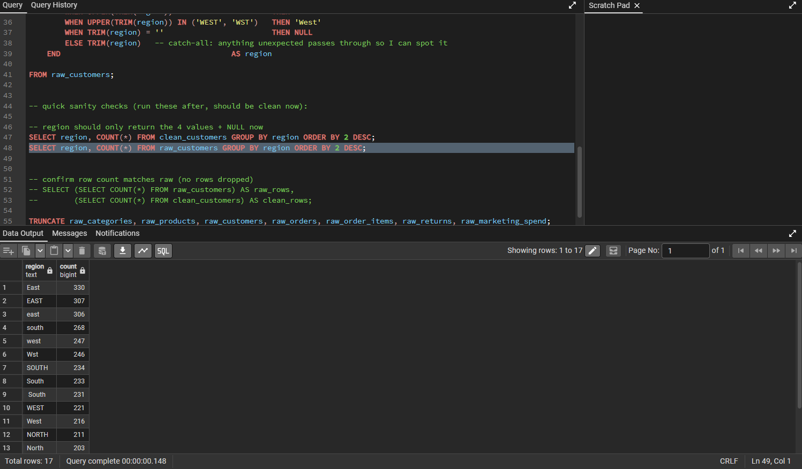
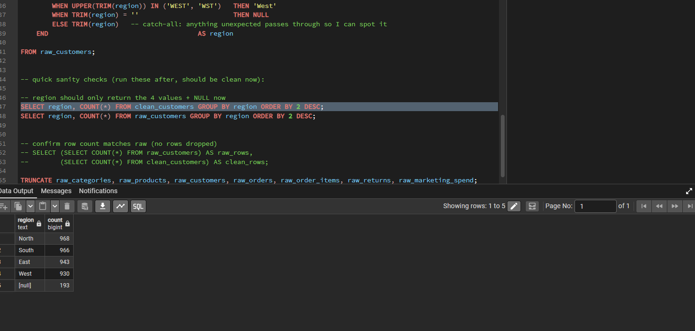
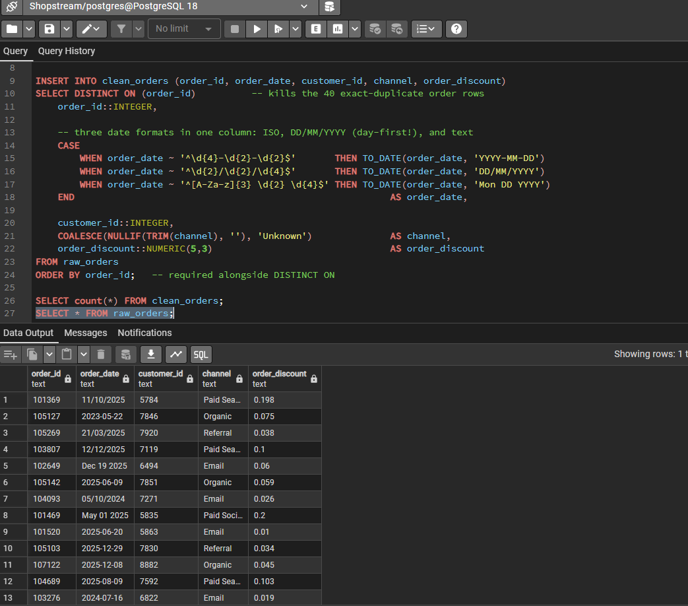
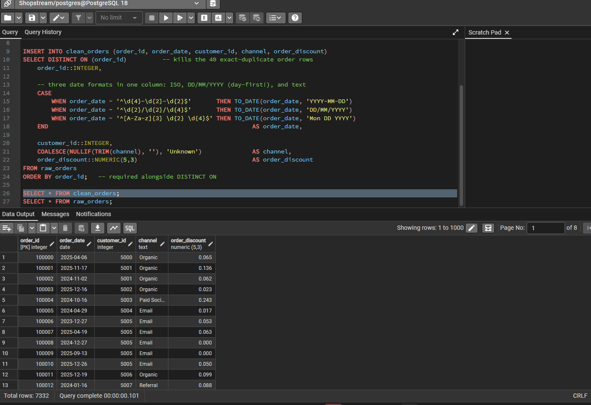
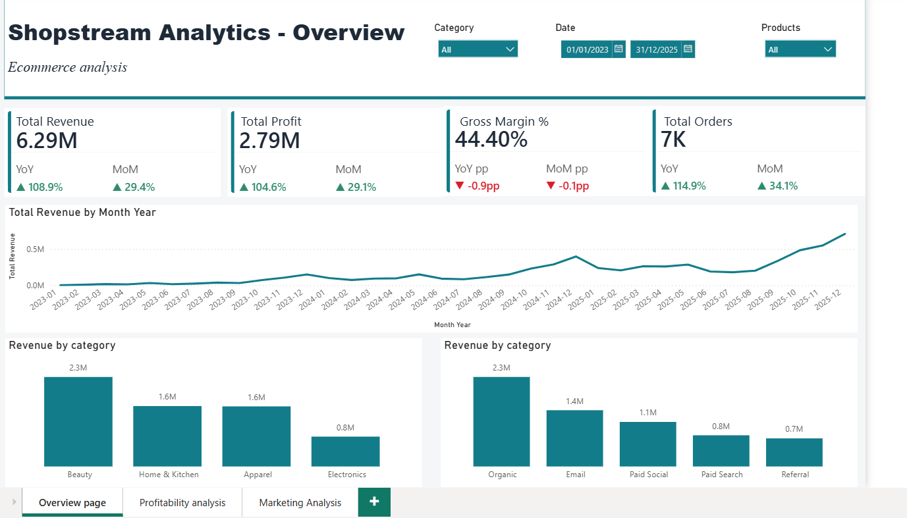
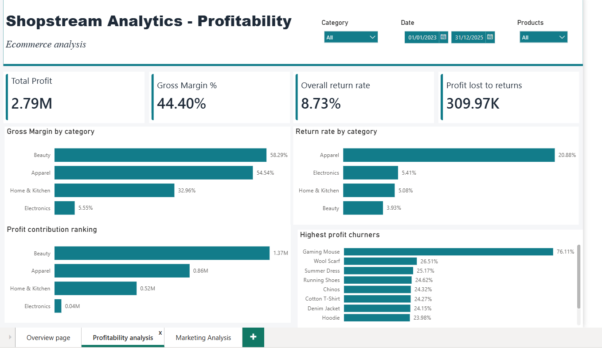
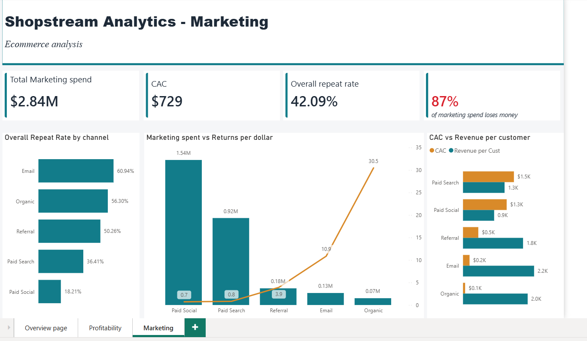

# ShopStream — Where a Growing E-Commerce Business Is Quietly Leaking Profit

**An end-to-end analytics project: PostgreSQL → data cleaning → SQL analysis → Power BI**

> ShopStream's revenue has grown ~50× in three years. But growth was hiding three profit leaks — and the biggest one was self-inflicted: **87% of the marketing budget goes to channels that lose money on every customer they bring in.**

---

## The Business Question

ShopStream is an online retailer selling across four categories (Beauty, Apparel, Home & Kitchen, Electronics) and four regions. Revenue is climbing fast. On the surface, everything looks healthy.

But *revenue growth hides problems*. The real question a business owner should ask isn't "are we growing?" — it's **"are we growing profitably, and if not, where is the money leaking?"**

This project traces the data from raw, messy exports all the way to a decision-ready dashboard to answer exactly that.

---

## The Approach

A full analytics pipeline, built for correctness at every stage:

| Stage | Tooling | What happened |
|---|---|---|
| **Storage** | PostgreSQL | Raw data loaded into staging tables |
| **Cleaning** | SQL | Raw → clean layer, with integrity enforced by schema constraints |
| **Analysis** | SQL | Insight queries + a pre-computed channel-performance view |
| **Visualization** | Power BI | 3-page dashboard with DAX measures and time intelligence |

The guiding principle: **push transformation upstream (SQL), keep the BI layer thin (DAX for filter-responsive measures only).**

---

## Step 1 — The Data Was a Mess (and Cleaning Is Half the Job)

Real data never arrives clean. The raw ShopStream exports had exactly the kind of problems that silently break analysis:

| Issue | Example | Fix |
|---|---|---|
| **17 inconsistent region spellings** | `NORTH`, `north`, `North `, `Nort`, blanks | Standardized to 4 clean values + `Unknown` |
| **3 date formats in one column** | `2025-06-09`, `11/10/2025`, `Dec 19 2025` | Detected each format, parsed (day-first, not US) |
| **Prices stored as text** | `$1,299.00` | Stripped `$`/commas, cast to numeric |
| **Negative quantities** | 187 invalid order lines | Flagged and excluded, documented |
| **Orphaned product IDs** | 25 lines referencing non-existent products | Filtered against valid products |
| **Duplicate orders** | 40 duplicate rows | De-duplicated (7,372 → 7,332 orders) |

**Integrity was enforced, not just cleaned:** the clean tables use explicit `PRIMARY KEY`, `NOT NULL`, and `FOREIGN KEY` constraints — so bad data is *prevented*, not just detected. Nothing was silently deleted; every exclusion was counted and documented.

### Before / After

**Region — 17 inconsistent spellings collapsed to 4 clean values:**

| Before | After |
|---|---|
|  |  |

**Order dates — three formats in one column, standardized to a single date type:**

| Before | After |
|---|---|
|  |  |

*Why this matters: a dashboard is only as trustworthy as the data beneath it. Most portfolios skip the cleaning story — but it's where the real reliability is earned.*

---

## Step 2 — What the Data Revealed

### Finding 1 — The business is growing fast, and it's seasonal

Revenue grew from a few thousand dollars a month in early 2023 to **$710K in December 2025**, with a pronounced Q4 peak every year and a summer trough. Year-over-year, revenue more than doubled (**+108.9%**).

*So what: this is a scaling business — which makes the profit leaks below urgent, not academic.*

### Finding 2 — Ranking categories by revenue hides where profit comes from

| Category | Revenue | Margin |
|---|---|---|
| Beauty | $2.35M | **58.3%** |
| Apparel | $1.58M | 54.5% |
| Home & Kitchen | $1.58M | 33.0% |
| Electronics | $0.78M | **5.6%** |

Apparel and Home earn nearly identical revenue — but Apparel is **21 percentage points** more profitable. And Electronics sells real volume at almost no margin.

*So what: manage categories by profit contribution, not revenue. Beauty is the quiet engine; Electronics is close to break-even.*

### Finding 3 — Apparel's returns are eroding its profitability

Apparel's return rate is **22.1%** — more than 4× every other category (~5%). A category that looks strong on margin is quietly bleeding profit back out the door, product by product.

*So what: sizing guidance and quality review on high-return Apparel SKUs could recover meaningful margin.*

### Finding 4 — The headline: 87% of marketing spend loses money

This is where the biggest, most fixable problem sits.

| Channel | Spend | Return per $1 (value-to-CAC) | Repeat rate |
|---|---|---|---|
| **Paid Social** | **$1.54M** | **$0.71** ❌ | 18.2% |
| **Paid Search** | **$0.92M** | **$0.82** ❌ | 36.4% |
| Referral | $0.18M | 3.9× | 50.3% |
| Email | $0.13M | 10.9× | 60.9% |
| Organic | $0.07M | **30.5×** ✅ | 56.3% |

ShopStream spends its **two largest budgets** on the **two channels that lose money** on every customer — customers who also rarely return. Meanwhile Organic, which returns **30× its cost**, is barely funded.

**86.7% of the total marketing budget flows to channels that don't pay back.**

*So what: reallocating budget from Paid Social/Search toward Organic and Email is the single highest-impact lever in the business.*

---

## Recommendations

1. **Reallocate marketing spend** away from Paid Social & Paid Search toward Organic and Email — the channels that actually retain and repay.
2. **Manage categories by profit, not revenue** — invest in Beauty, scrutinize Electronics' role.
3. **Fix Apparel returns** — sizing guides and SKU-level review to recover trapped margin.
4. **Use the summer lull** for retention campaigns to the loyal Organic/Email base.

---

## The Dashboard

A 3-page Power BI report:

**Page 1 — Overview:** KPIs with YoY/MoM growth, revenue trend, category & regional breakdown.



**Page 2 — Profitability:** margin, returns, and profit contribution by category; product-level profit erosion.



**Page 3 — Marketing:** the channel-value discrepancy, CAC vs return, and repeat rates.



---

## Tech Stack

- **PostgreSQL** — storage, cleaning, analytical views
- **SQL** — cleaning pipeline (raw → clean), insight queries
- **Power BI** — data model (star schema), DAX measures, time intelligence, 3-page report

## Repository Structure

```
/sql
  01_create_raw_tables.sql
  02_clean_customers.sql
  03_clean_orders.sql
  ...
  vw_channel_performance.sql
  shopstream_analysis.sql
/images
  raw_regional_group.png      # cleaning: before
  clean_regional_group.png    # cleaning: after
  raw_orders.png              # cleaning: before (mixed date formats)
  clean_orders.png            # cleaning: after
  page1_overview.png          # dashboard
  page2_profitability.png     # dashboard
  page3_marketing.png         # dashboard
README.md
```

---

*Built as a portfolio project to demonstrate the full analytics workflow — from messy raw data to a decision-ready story. The data is synthetic, modeling realistic e-commerce patterns.*
